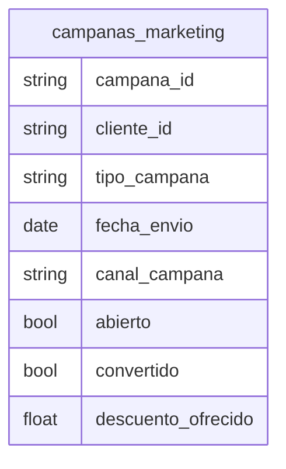

# Campañas de Marketing

## Python

[Implementacion](../../src/retailventure_dss/etl/models/campanas_marketing.py)

## CSV

| atributo           | formato      |
| ------------------ | ------------ |
| campana_id         | `CAM0000000` |
| cliente_id         | `CLI00000`   |
| fecha_envio        | `yyyy-mm-dd` |
| abierto            | `0\|1`       |
| convertido         | `0\|1`       |
| descuento_ofrecido | `0.00`       |

### Restricciones

- descuento_ofrecido >= 0.00
