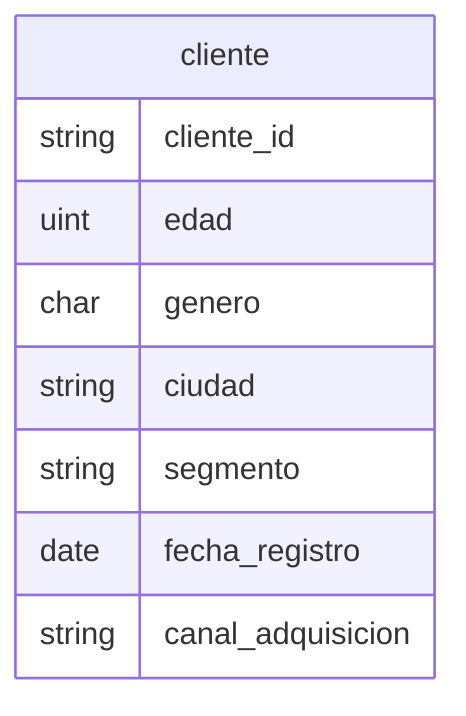

# Clientes

## Python

[Implementacion](../../src/retailventure_dss/etl/models/clientes.py)

## CSV

| atributo       | formato                 |
| -------------- | ----------------------- |
| cliente_id     | `CLI00000`              |
| genero         | `M\|F\|No especificado` |
| fecha_registro | `yyyy-mm-dd`            |
