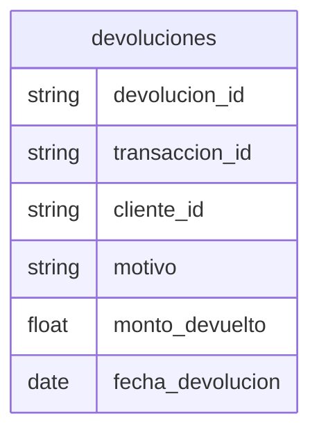

# Devoluciones

## Python

[Implementacion](../../src/retailventure_dss/etl/models/devoluciones.py)

## CSV

| atributo         | formato      |
| ---------------- | ------------ |
| devolucion_id    | `DEV000000`  |
| transaccion_id   | `TRX0000000` |
| cliente_id       | `CLI00000`   |
| monto_devuelto   | `0.00`       |
| fecha_devolucion | `yyyy-mm-dd` |

### Restricciones

- monto_devuelto >= 0.00
