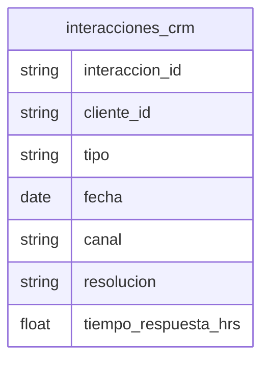

# Interacciones CRM

## Python

[Implementacion](../../src/retailventure_dss/etl/models/interacciones_crm.py)

## CSV

| atributo             | formato      |
| -------------------- | ------------ |
| interaccion_id       | `INT0000000` |
| cliente_id           | `CLI00000`   |
| fecha                | `yyyy-mm-dd` |
| tiempo_respuesta_hrs | `0.0`        |

### Restricciones

- tiempo_respuesta_hrs >= 0.0
