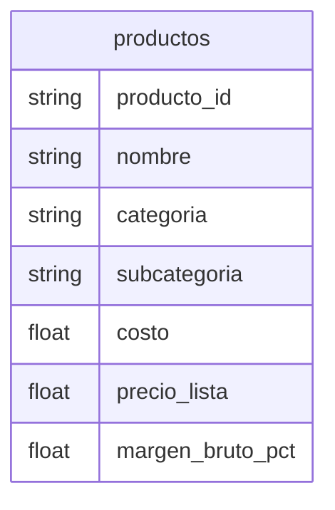

# productos

## Python

[Implementacion](../../src/retailventure_dss/etl/models/productos.py)

## CSV

| atributo         | formato   |
| ---------------- | --------- |
| producto_id      | `PRD0000` |
| costo            | `0.00`    |
| precio_lista     | `0.00`    |
| margen_bruto_pct | `0.0`     |

### Restricciones

- costo >= 0.00
- precio_lista >= 0.00
- margen_bruto_pct >= 0.0
