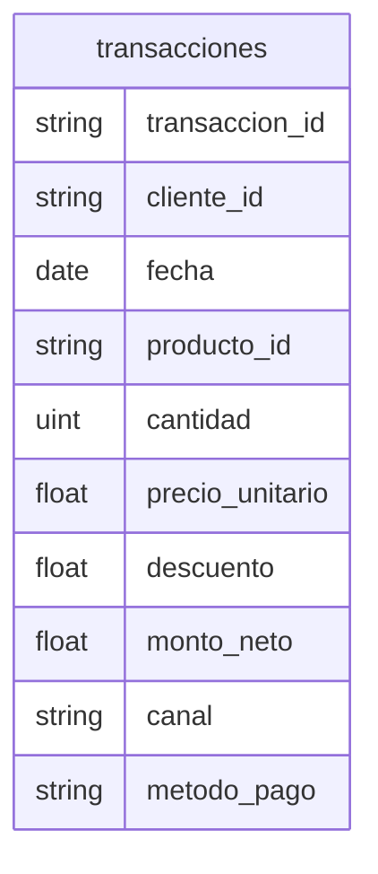

# Transacciones

## Python

[Implementacion](../../src/retailventure_dss/etl/models/transacciones.py)

## CSV

| atributo        | formato      |
| --------------- | ------------ |
| transaccion_id  | `TRX0000000` |
| cliente_id      | `CLI00000`   |
| fecha           | `yyyy-mm-dd` |
| producto_id     | `PRD0000`    |
| precio_unitario | `0.00`       |
| descuento       | `0.000`      |
| monto_neto      | `0.00`       |

### Restricciones

- precio_unitario => 0.00
- cantidad > 0
- descuento => 0.000
- monto_neto => 0.00
