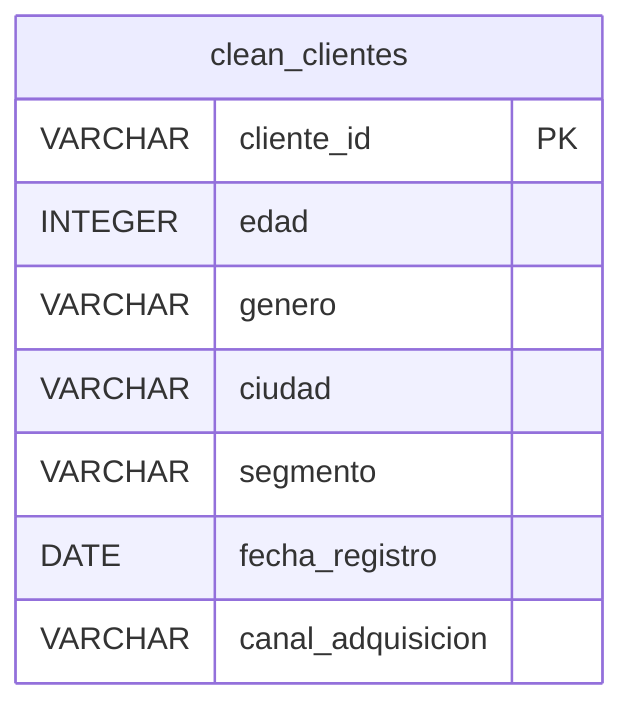

# clean_clientes

## representacion

| cliente_id | edad | genero | ciudad | segmento | fecha_registro | canal_adquisicion |
| --- | --- | --- | --- | --- | --- | --- |
| pk |  |  |  |  |  |  |
|  |  |  |  |  |  |  |
| VARCHAR | INTEGER | VARCHAR | VARCHAR | VARCHAR | DATE | VARCHAR |
|  |  | CHECK (genero IN ('M', 'F')) |  |  |  |  |
